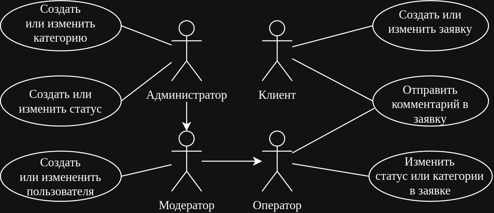

# Техническое задание

## Краткое описание

На текущий момент в данной области отсутствует прямая связь между пользователями и технической поддержкой. Со стороны технической поддержки это затрудняет обнаружение, устранение, систематизацию и предотвращение проблем. Со стороны пользователей это создаёт неопределённость ("уже известно о проблеме?", "о каких проблемах я сообщал ранее, в каком они статусе?").

## Назначение

Необходима система, которая со стороны позволит пользователям удобным способом подавать заявки, а со стороны поддержки быстро реагировать на них.

## Роли

1. Клиент - создание и изменение содержимого своей заявки, просмотр истории собственных созданных заявок
2. Оператор - просмотр истории созданных клиентами заявок, поиск по каталогу заявок, изменение статуса заявок, назначение заявке категорий
3. Модератор - всё перечисленное у оператора, создание и изменение пользователей, журнал действий по всей системе
4. Администратор - всё перечисленное у модератора, создание и изменение категорий, создание и изменение статусов заявок

## Функции

- Система должны предоставить возможность регистрации пользователей в роли клиента с отправкой логина-пароля на электронную почту
- Система должна предоставить возможность авторизации пользователей по логину-паролю
- Система должна разрешать создание новой заявки (тема, тело) для незаблокированных клиентов
- Система должна отображать историю заявок (тема, дата создания, дата последнего изменения, статус) на странице клиента
- При создании клиентом новой заявки, к ней автоматически прикрепляется доступный оператор
- При каждом изменении заявки система должна присылать уведомление на электронную почту клиенту и закреплённому за заявкой оператору
- Система должна предоставлять оператору поиск по ранее всем созданным заявкам (тема, тело, дата, пользователь, оператор)
- Система должна предоставлять возможность двухстороннего обмена сообщениями в каждой заявке
- Система должна предоставлять оператору возможность присвоения категорий и статуса заявке
- Система должна предоставлять модератору возможность создавать и изменять пользователей
- Система должна иметь глобальный журнал действий с заявками для модератора
- Система должна позволять модераторам выгружать журнал действий в формате CSV

## Нефункциональные требования

- Все статусы заявок должны иметь собственный отличительный цвет
- Система должна быть адаптирована под мобильные экраны
- Время запросов к системе (поиск, создание) не должно превышать 2 секунд
- Перед отправкой любого запроса на создание, изменения и/или удаление сущностей система должна запрашивать подтверждение во всплывающем окне
- Система не должна хранить пароли в исходном виде
- Интерфейс системы должно корректно отображаться в последней стабильной версии популярных браузеров: Google Chrome, Mozilla Firefox, Microsoft Edge, Yandex.Browser

## Сущности

- Пользователь
- Заявка
- Статус заявки
- Категория заявки
- Комментарий в заявке
- Изменение заявки

## Сценарии

## Критерии приёмки

- Система содержит и полностью выполняет все пункты, описанные в [разделе «Функции»](#функции)
- Система содержит и полностью выполняет все пункты, описанные в [разделе «Нефункциональные требования»](#нефункциональные-требования)
- Система соответствует требования, указанным в [разделе «Назначение»](#назначение)
